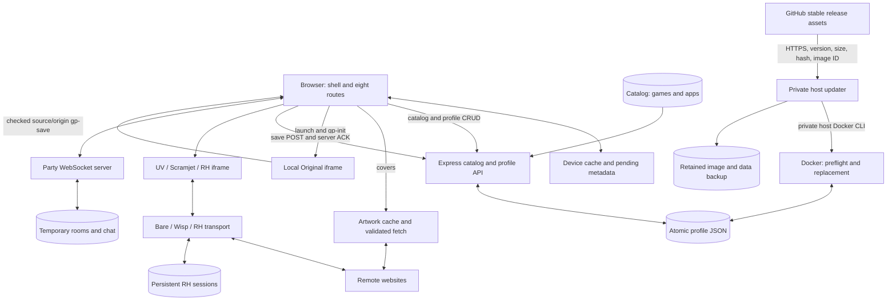

> Public copy. UI screenshots and local runtime evidence remain in the private workspace.

# Aether 5.0.0: current-source audit

**Date:** 2026-10-09. **Scope:** `local workspace`. **Method:** named `app-auditor` skill, fresh application code trace, documented startup, actual browser evidence, screenshot inspection, and clearly separated static inferences. This replaces earlier audit conclusions. The auditor changed only scratch evidence and reports.

## Result

The eight-page shell, 16 local Originals, curated library, Focus workspace, supported profile saves, and three proxy launch paths are implemented. Captured desktop and phone layouts are cohesive. Actual browser evidence proves representative working journeys. Claiming every remote game works, or that this is a secure public service, would be bullshit.

Three high-impact findings remain: the proxy/profile trust boundary, Rammerhead's disabled destination certificate validation, and vulnerable dependency chains. These are architectural/dependency risks, not demonstrated exploits. Launch failure detection is the remaining medium issue. Functional defects found during this audit were corrected by the implementation team and re-read below.

## Documented startup and evidence ownership

README was read before tracing or running the app. Its exact commands were used:

```powershell
npm ci
$env:PORT = '15000'
$env:USERS_DIR = Join-Path (Get-Location) '.Codex\audit-v5-userdata'
npm start
```

The first install encountered a loaded native DLL on Windows. After coordination, the auditor verified and stopped only the known preview `node.exe server.js` PID 10716, then reran `npm ci` successfully: 192 packages added, 193 audited, six high and two moderate advisories. The hidden replacement ran the exact README environment and `npm start`. Logs identify Aether 5.0.0 and disposable userdata. Only the inherited `NODE_TLS_REJECT_UNAUTHORIZED` variable in the startup subprocess was removed. Evidence: `start-readme-preview.ps1`, `readme-preview.stdout.log`, `readme-preview.stderr.log`. A subsequent HTTP read of port 15000 `/health` returned `ok:true`, `version:5.0.0`.

Root captured and exercised the live app through CUA. This auditor inspected saved images and independently traced code; this subagent had no usable independent browser inventory. An older native close dialog in another tab later stalled CUA input. That automation limitation is not an app failure. Final file-picker, popup, Party chat UI, and checkbox journeys are not marked passed. Screenshots without a `v5-` prefix are excluded. Home desktop and both proxy overview captures were refreshed after the final source reload: scroll position zero, correct fresh-session RH copy, and actual 390 px phone width. Contact sheets were regenerated from these files. Current audit source hashes (local evidence) identify the reviewed files.

## Trace coverage

| Surface | Files and paths examined | Calls and state followed |
| --- | --- | --- |
| Shell | `public/index.html`, `public/app.js`, `public/styles.css` | Eight hash routes; navigation; search/filter/sort/paging; favorites/recents; command palette; modal focus/inert behavior; launch/recovery; settings; timer/tasks/notes; import/export/delete; cache and pending writes |
| Originals | `public/arcade/{index.html,main.js,games.js,core.js,arcade.css,catalog.json,tests/core.test.mjs}` | Every renderer/rule; pause/reset/timers; keyboard/touch controls; local stats; parent messages; profile initialization |
| API/data | `server.js`, `data/games.json` | 202 games, 27 apps; artwork fetch/cache; profile persistence; every HTTP/WebSocket handler; proxy dispatch; compression/ETags; resource limits |
| Workers | `public/uv/{uv.config.js,sw.js}`, generated Scramjet worker in `server.js` | UV/Bare, Scramjet/Libcurl/Wisp, secure-context requirement, RH sessions, credentialless iframe, persistent sessions and compatibility adapter |
| Packaging/tools | `package.json`, `Dockerfile`, `.dockerignore`, manual build workflow, `tools/{measure-transfer.mjs,archive-image.py,release.ps1}` | Node 22, Linux AMD64 export, version label, build exclusions, transfer measurements, local release publishing |
| Host updater | `tools/{aether-updater.py,start-aether-updater.sh,test-updater.py}`, `docs/AUTO-UPDATES.md` | Pinned release URLs; stable version comparison; hash/image validation; preservation checks; preflight; backup/replacement/rollback; state/event watcher/kernel lock |
| Docs/assets | README, BUILD-AND-DEPLOY, release/performance/brand/arcade/source docs, research schema, Original covers, local logos and Outfit license | Claims versus implementation, fallback artwork, provenance, retained license |

Excluded from a line-by-line trace: installed vendors, lockfiles, image archives, binary/generated assets and research records, temporary test output, and runtime userdata. Installed Hammerhead TLS paths were inspected narrowly for H2. This traces application-owned code; it is not a claim that every third-party engine byte was audited.

### Routes and real journeys

| Entry point | Journey and outcome | Evidence boundary |
| --- | --- | --- |
| `/#home` | Discovery cards, Originals collection, recents, Focus; repaired collection CTA selects local games | Screenshot/code; last CTA regression belongs to implementation QA |
| `/#games` | Search/filter; 48 to 96 pagination; 16-Original filter; empty reset; favorite and reload | Root live CUA passed; remaining remote catalog gameplay unverified |
| `/#apps` | Search/category/favorites; 27 destinations; shared viewer launch | Controller traced and desktop/phone captured; no blanket external account/login/editing claim |
| `/#focus` | Start/pause timer, Enter adds task, notes persist after reload | Root live proof; retry/offline corrections reviewed separately |
| `/#multiplayer` | Public room create/join, members/history/chat/shared state, leave; ACK/error/reconnect | Current trace plus earlier two-protocol-client evidence; final native chat UI unverified |
| `/#proxies` | Enter launches UV; Aether entry launches Scramjet; RH creates session inside retained toolbar | Example Domain loaded with each engine; fresh patched RH had no console errors/warnings; credentialless support required for RH |
| `/#profile` | Reveal/copy capability; switch UUID; compact export; restore current profile; grouped deletion | Code/screenshots; final native file download/chooser/confirmation unverified |
| `/#settings` | Motion/density/new-tab/default-Focus/leave preference; shortcuts; export/delete | Code/screenshots; no blanket checkbox or popup interaction claim |
| `/arcade/index.html?game=…` | All 16 routes initialize with correct heading and no console errors | Root current-source initialization, screenshot per game; selected completed rounds below |
| `?aether_game=…`, `?aether_proxy=…&aether_url=…` | Query entry consumes parameters, retains hash, supports new Aether tab | Controller traced; actual Scramjet/RH entry launches verified; popup permission flow unverified |

### HTTP/WebSocket inventory and persistence

- `GET /api/games`: parsed catalog, identity/gzip/Brotli bodies, ETag/cache policy.
- `GET /api/artwork`: exact catalog URL allowlist, public-IP checks and pinned DNS, HTTPS validation, bounded queue/cache/body/decompression/deadline, MIME validation.
- `GET /api/user`, `POST /api/save`, `POST /api/save-batch`, `GET /api/load/:key`, `DELETE /api/save/:key`, `GET /api/saves-by-game`, `DELETE /api/saves-by-game/:host`, `DELETE /api/user`, `POST /api/import`.
- `GET /api/rooms`, `GET /health`; shell/static/dependency routes; `/rammerhead.js` adapter and `/scramjet-sw.js`.
- `/bare/`, `/wisp/` and RH session/resource routes delegate to installed transports; `/ws` implements Party create/join/chat/state/leave, heartbeat, ACK/error, bounded rooms/members/history/messages/payload/backpressure.

Profiles use per-UUID write serialization, unique temporary files and atomic rename, concurrent-read coalescing, a bounded TTL cache, 8 MiB profile and 2 MiB individual-save limits, and corrupt-profile preservation on failure. The API JSON cap is now 9 MiB. Artwork private-address protections apply to artwork, not to all general proxy destinations. Party rooms are memory-only and intentionally reset on restart. Scores are client convenience statistics, not trusted competitive results.

## Data flow



Durable profiles/sessions, device retries, temporary Party state and private host deployment control are distinct. [Rendered SVG of the same flow](data-flow.svg):

*Screenshot retained in the local audit evidence.*

## Inspected screenshots

All eight primary routes have desktop and actual **390 × 700** phone captures. Incorrectly sized earlier phone copies were replaced; root measured full opacity and no horizontal overflow. The graphite/teal/violet system, cards, forms, desktop rail and compact phone bar are consistent. Phone navigation labels are small at 8 px. Screenshots establish rendering, not every control's operation.

| Page | Desktop | Phone |
| --- | --- | --- |
| Home | image (local evidence) | image (local evidence) |
| Games | image (local evidence) | image (local evidence) |
| Apps | image (local evidence) | image (local evidence) |
| Focus | image (local evidence) | image (local evidence) |
| Party | image (local evidence) | image (local evidence) |
| Proxies | image (local evidence) | image (local evidence) |
| Profile | image (local evidence) | image (local evidence) |
| Settings | image (local evidence) | image (local evidence) |

Inspected contact sheets embed all eight desktop and all eight phone pages; individual full-resolution files are linked above.

*Screenshot retained in the local audit evidence.*

*Screenshot retained in the local audit evidence.*

*Screenshot retained in the local audit evidence.*

### Sixteen distinct Original routes

Every ID has a saved `screenshots/v5-original-ID.jpg`: `snake`, `merge`, `breakout`, `mines`, `memory`, `tictactoe`, `connect4`, `slide`, `simon`, `reaction`, `color`, `scramble`, `lights`, `dodge`, `orbit`, `sudoku`. All are embedded in the inspected contact sheets:

*Screenshot retained in the local audit evidence.*

*Screenshot retained in the local audit evidence.*

*Screenshot retained in the local audit evidence.*

*Screenshot retained in the local audit evidence.*

Earlier actual-control checks completed Night Switch/Lights, all eight Memory pairs, and a full Sudoku; Snake collected food and hit a wall, retaining its result after reload; Orbit recorded hit/miss/end results. Other checks covered legal Merge moves, Mines flood/flag, Tic/Connect AI replies, legal Slide moves, Color symbol mode, and Reaction pause/false-start handling. Root then rechecked all 16 initializations and the nine pure-rule suites on current source, and observed an integrated Snake score 1 with a server **Saved** acknowledgement. Earlier standalone checks preceded the last shell changes; they are not represented as complete final-shell end-to-end tests.

*Screenshot retained in the local audit evidence.*

*Screenshot retained in the local audit evidence.*

*Screenshot retained in the local audit evidence.*

Research checked remote reachability and official-source artwork. HTTP 200 does not prove playable, embeddable, authenticated, or durable remote behavior. Agar.io's 403 is retained with an access note. The 186 remote games were not all played. The racing screenshot proves a title/road canvas loaded, not a completed round.

## Ranked remaining findings

### High H1: public proxy and profile trust boundary

**Where:** `server.js` cookie/API middleware, HTTP/upgrade dispatch; game iframe in `public/index.html`; client launch flow.

The server listens on all interfaces. General proxy transports have no application authentication gate and dispatch before Express profile origin checks. A UUID is the profile capability: importing it grants access; the cookie is intentionally JavaScript-readable. Proxied documents use the application origin and the viewer allows scripts plus same-origin behavior. Origin comparisons and this iframe permission combination do not provide an independent isolation boundary for arbitrary same-origin content. RH's credentialless frame reduces credential attachment for that frame; it does not create an authenticated multi-user architecture.

**Impact:** public/untrusted users can use server egress; profile keys are sensitive; arbitrary proxied content needs deliberately isolated origins and restricted transport access. This is a structural inference, not a demonstrated cookie-theft/API exploit. A capability model can be an explicit trusted-LAN product decision. Public exposure needs its own architecture decision.

### High H2: RH disables destination TLS certificate validation

**Where:** installed `testcafe-hammerhead/lib/request-pipeline/request-options.js:146` and `destination-request/agent.js:57`, reached through RH; documented in README/PERFORMANCE.

Both paths set `rejectUnauthorized` false. Removing an inherited shell TLS variable does not fix this internal behavior. **Impact:** RH can accept invalid destination certificates, weakening remote HTTPS trust. Do not generalize this finding to UV, Scramjet or artwork. A maintained upstream/fork correction or disabling RH until corrected is required.

### High H3: eight vulnerable dependency nodes reported

**Where:** `package.json`, installed RH graph, npm-audit.json (local evidence).

The successful clean install reported six high and two moderate vulnerable package nodes. The direct RH package has no automatic fix available. These include propagated chains, not eight distinct demonstrated remotely reachable exploits. Primary advisories describe [IP categorization/SSRF](https://github.com/advisories/GHSA-2p57-rm9w-gvfp), [Underscore recursion/DoS](https://github.com/advisories/GHSA-qpx9-hpmf-5gmw), and [UUID buffer bounds](https://github.com/advisories/GHSA-w5hq-g745-h8pq). Reachable call paths need triage. Do not force-upgrade the graph blindly and break proxy compatibility.

### Medium M1: iframe load is treated as successful launch

**Where:** `public/app.js` `frameLoaded`, `launchError`, 30-second timeout/recovery.

Any nonblank iframe load marks the launch loaded, clears the timer and hides recovery. A proxy error document can load while the requested site fails. Direct cross-origin frames cannot be inspected, so loading also does not validate gameplay. **Impact:** the explicit alternate-engine choice disappears after a loaded error document; the shell lacks a distinct unknown/blocked-site state. Toolbar reload and return remain available, so this is not a claim that the user is trapped. This is a code-inferred edge, not a falsely claimed failing-site reproduction.

### Low L1: Focus toggle announces stale state

**Where:** `index.html#focusToggle`, app `go`/`toggleFocus`. The control keeps `aria-pressed=false` and `Open Focus` even when its next action returns home. Update the name/state or use ordinary navigation semantics.

### Low L2: explicit reduced-motion choice stops at the shell

**Where:** shell settings and Original initialization/CSS. Parent preferences control shell animations; the child honors only the OS preference. Send the explicit app choice through the checked message channel for decorative UI. Preserve meaningful gameplay mechanics. Canvas games also lack equivalent screen-reader play modes; describe support accurately.

### Low L3: host updater rollback retention is unbounded

**Where:** updater backups/stopped containers and redirected log. Each update retains full userdata snapshots and the old image/container; logs grow. This is disclosed in AUTO-UPDATES, but no free-space/retention policy exists. Choose a conservative policy that retains the newest working rollback before pruning.

### Low L4: README source map names nonexistent paths

Apps live in `data/games.json`, not `data/apps.json`. Scramjet comes from installed assets and a generated server worker, not checked-in `public/scramjet/`. Correct the map for maintainers.

## Earlier findings corrected during this pass

The implementation team made these changes; the auditor re-read them. They are not remaining findings.

| Earlier finding | Current correction/evidence |
| --- | --- |
| Dead Originals collection and timer navigation | Both collection controls select local games; timer nav opens Focus |
| Failed metadata writes lost to server hydration | Profile-scoped pending ledger wins, replays, and clears only a matching acknowledged value |
| Backup exceeded old 4 MB restore cap | Compact export and 9 MiB client/server caps align with 8 MiB profiles; root reports >4 MiB restore and 8 MiB rejection checks |
| Prerequisites hidden in game library | Portal/room/account labels and launch notes shown |
| RH left the Aether viewer | Supported credentialless iframe retains toolbar; actual Example Domain and clean console |
| RH wrapper swallowed storage listener methods | Narrow server-served compatibility adapter; vendor files unchanged; identity/gzip/Brotli/HEAD/304/callable listener evidence |
| Unrelated viewer native confirmation and retained scroll | Viewer no longer uses Party leave preference; route changes reset scroll |
| Tablet controls unnamed when text hidden | All navigation, timer and sidebar-search controls have explicit names |
| Initial offline metadata had no owner/recovery | `cookieProfileUUID()` initializes and rereads a response-created cookie on failure; successful boot adopts offline pending once and clears it after persistence; UUID import does not adopt the queue |

Root reports ten current backend checks, including large backup, profile limit, 24 concurrent saves, HTTP 304, core assets, RH listeners and private-artwork rejection. These supplement independent source review; the auditor did not rerun that harness or mislabel it as its own test.

## Extended host-updater assessment

The updater is outside the public web image. It uses private host Docker CLI access; pinned GitHub HTTPS hosts/repository/tag assets; stable numeric versions; bounded download sizes; matching hash/platform/tag/image ID/version label; uniquely named and ownership-labelled isolated preflight data; strict managed-container preservation checks; stopped-write snapshots; post-replacement health/version checks; and restoration of old image/data after caught replacement failure. Final code also rechecks the original container after preflight, journals transaction phases before the switch, validates/extracts a rollback archive before changing live files, preserves failed-image userdata during restore, and marks incomplete recovery as requiring administrator action. State uses temporary-file replacement, failed health versions are remembered, events coalesce, and a kernel lock prevents duplicate watchers. Manually stopped applications are not started by a check.

The reviewed `UPDATER-TESTS.log` reports 20 passing mocked-Docker tests, including failures after stop/rename/run, partial backup, failed preflight, unsafe restore, ownership collision, unsupported configuration and incomplete recovery. This does not prove a real future NAS replacement/rollback. Root separately reports that the live NAS container contract was validated and the private supervisor installed; the boot watcher/restart check awaited the public release at this audit cutoff. Final host checks belong in DEPLOYMENT.md. A release publisher can provide code the NAS runs. Hashes verify agreement, not independent authenticity against a compromised publisher. Documentation explicitly discloses publisher trust, brief outage, manual power-loss recovery and retained backups.

## Final release evidence

The auditor read the final artifacts, separately from the earlier candidate:

- `outputs/v5.0.0/IMAGE-MANIFEST.json`: genuine Linux AMD64 `aether:5.0.0` archive, **81,575,636 bytes**; SHA-256 **73dd468411b6fb5a3b026b7c2c05d85ba987cc49b725c74261995cf919e73b85**; image ID **sha256:f4cd0d96d3009f59bad417cb50dafdebdaeb9b8b80cc09b7fd146f0309f20eb1**.
- `FINAL-SOURCE-INTEGRITY.json`: **111 matched shipped files, zero mismatches**.
- `FINAL-CONTAINER-TESTS.log`: **10 checks passed**, including version/catalog, concurrent saves, >4 MiB backup, invalid/foreign-origin rejection, 8 MiB profile limit, HTTP ETag/HEAD/compression, core assets, RH adapter/session and private-artwork rejection; 44 saved keys recorded. Root reports those keys survived the final container restart.
- `UPDATER-TESTS.log`: **20 mocked-Docker checks passed**. These are separate from the ten real-container backend checks.

Root reports NAS Aether 5.0.0 and public HTTPS health confirmed, `aether-data` preserved, and a retained 4.1.1 rollback backup. Root also loaded actual Example Domain through deployed UV without console errors; deployed Scramjet and the release-triggered watcher check were still in progress at this report cutoff. These deployment statements are attributed to the deployment owner, not presented as this subagent's own NAS/browser session.

## Limits and completion

- No blanket verification of 186 remote games, external accounts/plans, third-party cookies, every browser, fullscreen/popup permissions, or every game gesture.
- Final native backup-file chooser, popup, destructive confirmation and Party chat UI journeys remain unverified after CUA input stalled.
- No exhaustive Breakout/Dodge long-session physics or all win/loss paths. Earlier Reaction observed four successful attempts, not a finished five-attempt average.
- Docker evidence named `BEFORE-SHELL-FIX` or under `candidate-before-audit-fixes` proves that candidate only. The final artifact identities and current validation are recorded above; remaining deployed proxy/watcher checks belong to the release workstream.
- This read-only audit and its concrete [IMPROVEMENT_PLAN.md](IMPROVEMENT_PLAN.md) are complete. Keep evidence until implementation/deployment handoff finishes. No security architecture change was implemented by this auditor.
